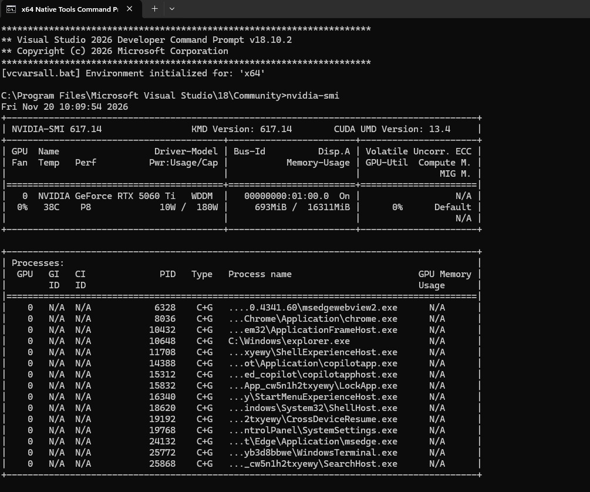
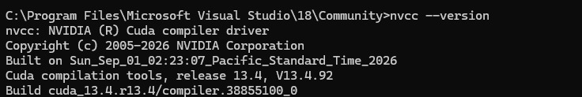
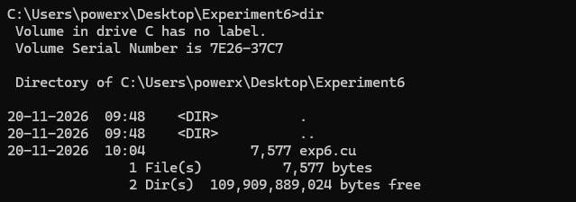
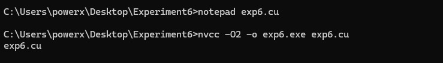
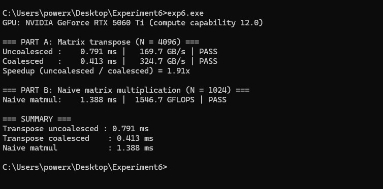
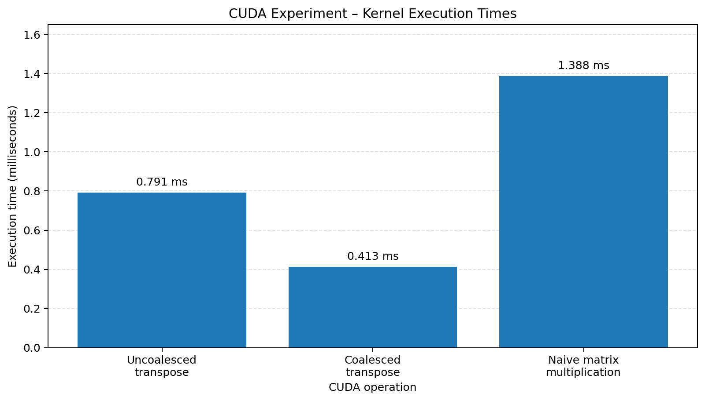

# Memory Optimization in CUDA – Experiment 6

## 1. Experiment overview

This experiment uses NVIDIA CUDA to implement and measure GPU matrix operations. It compares an uncoalesced matrix-transpose kernel with a coalesced matrix-transpose kernel, and also runs a naive matrix-multiplication kernel.

## 2. Aim

To implement CUDA matrix transpose and matrix multiplication, measure their execution performance, and compare the effects of coalesced and uncoalesced global-memory access.

## 3. Operations performed

1. **Uncoalesced matrix transpose:** Transposes a 4096 × 4096 matrix using the basic kernel.
2. **Coalesced matrix transpose:** Transposes a 4096 × 4096 matrix using a coalesced memory-access pattern.
3. **Naive matrix multiplication:** Multiplies matrices using a basic CUDA kernel with N = 1024.

## 4. Hardware and software

| Item | Observed configuration |
|---|---|
| GPU | NVIDIA GeForce RTX 5060 Ti |
| Compute capability | 12.0 |
| CUDA Toolkit / compiler | CUDA 13.4 (nvcc V13.4.92 shown in screenshot) |
| Operating environment | Windows, Visual Studio 2026 x64 Native Tools Command Prompt |

## 5. Steps to perform the experiment

Run the commands from the repository root folder.

### Step 1 – Check the NVIDIA GPU

```cmd
nvidia-smi
```
**Explanation:** Displays the installed NVIDIA GPU, driver information, CUDA compatibility information, and current GPU status.



### Step 2 – Check the CUDA compiler version

```cmd
nvcc --version
```
**Explanation:** Prints the installed NVIDIA CUDA compiler version.



### Step 3 – Check the experiment source file

```cmd
dir
```
**Explanation:** Lists the files in the experiment working directory. The original working directory contained `exp6.cu`.



### Step 4 – Compile the CUDA program

After placing the source file at `code/exp6.cu`, run:

```cmd
nvcc -O2 -o exp6.exe code\exp6.cu
```
**Explanation:** Compiles the CUDA source using optimization level `-O2` and creates the executable `exp6.exe` in the repository root.

The supplied compilation screenshot shows the successful compilation command from the original `Experiment6` folder, where the source file was named `exp6.cu`.



### Step 5 – Execute the program

```cmd
exp6.exe
```
**Explanation:** Runs the compiled CUDA executable and prints GPU information, kernel timings, performance measurements, and verification status.



## 6. Results

| Operation | Matrix size | Execution time | Measured performance | Verification |
|---|---:|---:|---:|---|
| Uncoalesced transpose | 4096 × 4096 | 0.791 ms | 169.7 GB/s | PASS |
| Coalesced transpose | 4096 × 4096 | 0.413 ms | 324.7 GB/s | PASS |
| Naive matrix multiplication | 1024 × 1024 | 1.388 ms | 1546.7 GFLOPS | PASS |

The measured transpose speedup is **1.91×** (uncoalesced time divided by coalesced time). All three operations reported `PASS`.

The raw terminal output is saved in [`results/Experiment6_Output.txt`](results/Experiment6_Output.txt), and a machine-readable table is available in [`results/results.csv`](results/results.csv).

## 7. Execution-time graph



The graph compares the measured execution times in milliseconds. The coalesced transpose completed faster than the uncoalesced transpose in this run.

## 8. Directory structure

```text
Memory-Optimization-in-CUDA/
├── .gitignore
├── README.md
├── code/
│   └── exp6.cu                  # Copy your CUDA source file here
├── results/
│   ├── Experiment6_Output.txt
│   └── results.csv
├── screenshots/
│   ├── 01-gpu-detection.png
│   ├── 02-cuda-version.png
│   ├── 03-source-directory.png
│   ├── 04-compilation.png
│   └── 05-execution.png
└── graphs/
    └── experiment6_results.png
```

## 9. Conclusion

The CUDA program ran successfully on the NVIDIA GeForce RTX 5060 Ti. All three operations passed verification. In this measured run, the coalesced transpose took 0.413 ms compared with 0.791 ms for the uncoalesced transpose, giving a reported speedup of 1.91×. The naive matrix multiplication reported 1546.7 GFLOPS.

*Note: Timings and throughput are from this particular run and may vary with GPU load, clocks, drivers, and system conditions.*
